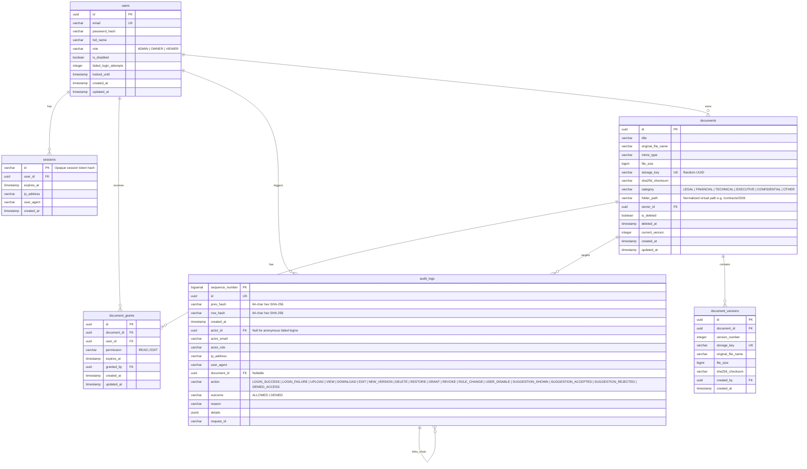

# TrustVault — Architecture & Implementation Plan

> **Core Promise**: The wrong person can never read a file, and we can prove who read it.
> Security-first document sharing with an immutable, tamper-evident audit trail, centralized zero-trust authorization, and instantaneous revocation.

---

## 1. System Architecture

TrustVault is architected as a hardened full-stack web application designed to eliminate information leakage, privilege escalation, bypassable access controls, and silent audit failures.

### High-Level Topology
```
                          [ Client Browser ]
                                   │
                                   ▼ (HTTPS, Strict Headers, SameSite=Lax, Origin Check)
                      [ Next.js Edge / App Router ]
                     /              │             \
         (Public Pages)     (API Handlers)    (Protected UI)
                                    │
                                    ▼
                        [ Central Policy Engine ]
                       (can(user, action, doc))
                               /         \
                              ▼           ▼
        [ Storage Abstraction Layer ]   [ PostgreSQL (Drizzle ORM) ]
          - Random storage key (UUID)      - ACID Transactions & Advisory Locks
          - Local volume / S3 private      - Append-only Audit Table with DB Trigger
          - Streaming policy validation    - SHA-256 Hash Chain verification
          - Never direct public URL        - SQL-level grant filtration
```

### Core Architectural Decisions & Trade-offs
1. **Central Policy Engine as Single Chokepoint**:
   - Every file download, preview, metadata retrieval, edit, delete, and share request MUST pass through `src/server/policy/index.ts: can(user, action, document)`.
   - No route handler or server action performs inline role comparisons (`user.role === 'ADMIN'`).
   - All list and search queries enforce access at the SQL query level to prevent in-memory filtering data leaks.

2. **Immediate Revocation via Streaming Proxies (No Signed URLs)**:
   - *Decision*: TrustVault strictly rejects pre-signed S3 URLs or long-lived download tokens. Every byte streamed passes through an authenticated Node.js stream that verifies active session, user enablement status, and active grant validity.
   - *Trade-off*: In exchange for slightly higher server bandwidth and CPU consumption compared to direct S3 pre-signed downloads, revocation is 100% instantaneous. A grant revoked at $t=0$ immediately terminates downloads at $t+1\,\text{ms}$, including range requests and concurrent preview streams.

3. **Opaque Database-Backed Sessions**:
   - *Decision*: Session tokens are 256-bit cryptographically secure random strings (`crypto.randomBytes(32).toString('hex')`) stored hashed in PostgreSQL with expiration timestamps.
   - *Trade-off*: Every incoming request queries the database session table (cached or fast index lookup). Revoking a user immediately deletes all their active sessions, preventing any "JWT window of vulnerability".

4. **Tamper-Evident Hash Chain with PostgreSQL Triggers**:
   - Each audit row contains `id`, `prev_hash`, `row_hash`, `timestamp`, `actor_id`, `ip_address`, `user_agent`, `document_id`, `action`, `outcome` (ALLOWED/DENIED), `details_json`, `request_id`.
   - `row_hash = SHA256(prev_hash + canonical_json(row_data))`
   - Concurrency is managed via PostgreSQL transaction-level advisory locks (`pg_advisory_xact_lock(424242)`) so sequential hashing remains strictly serialized and uninterrupted.
   - Native PostgreSQL triggers `BEFORE UPDATE` and `BEFORE DELETE` abort any mutation with a database exception. Application DB role is restricted to `INSERT` and `SELECT`.

5. **Uniform 404 & Constant-Time Responses**:
   - Any access attempt for a document that does not exist OR for which the caller has no grant returns an identical 404 response payload: `{ "error": { "code": "NOT_FOUND", "message": "Document not found" } }`.
   - The denial is nevertheless logged in the internal audit trail with the true reason (`UNAUTHORIZED_ATTEMPT`, `UNKNOWN_DOCUMENT`, etc.).

---

## 2. Data Model

The schema is defined using Drizzle ORM targeting PostgreSQL.

### Tables & Relationships



---

## 3. Permission Model

### Roles Specification
- **`ADMIN`**:
  - Manages users (invite, change roles, disable, view user list).
  - Inspects global audit trail, audit chain verification status, security alerts, and system health metrics.
  - **Explicit Architectural Boundary**: An `ADMIN` cannot read, view, stream, download, or edit documents unless explicitly granted by the document owner, exactly like any other user. Admins inspect only metadata and audit events.
  - *Rationale*: Eliminates the "compromised administrator reads all confidential IP" threat vector. Custodianship of the system is decoupled from ownership of the contents.
- **`OWNER`**:
  - Uploads, updates, creates versions, organizes, deletes, and restores own documents.
  - Grants and revokes `READ` or `EDIT` permissions to named system users.
  - Inspects granular activity timelines for documents they own.
  - Implicit full control over owned documents.
- **`VIEWER`**:
  - Sees, reads, and downloads ONLY documents where an active, unexpired grant exists.
  - Cannot upload documents or change sharing settings.
  - Default: DENY.

### Central Policy Engine Contract: `can(user, action, document, context)`
Supported Actions:
- `view`: See document metadata and detail page.
- `download`: Stream file payload or preview.
- `edit`: Rename, update metadata, upload new version.
- `delete`: Soft-delete or restore document.
- `share`: Create or revoke grants on document.
- `viewActivity`: View audit log events for document.

#### Evaluation Logic Table
| Action | Admin | Owner of Doc | User with EDIT grant | User with READ grant | Unlisted User |
|---|:---:|:---:|:---:|:---:|:---:|
| `view` | ❌ (DENY unless granted) | ✅ (ALLOW) | ✅ (ALLOW if active) | ✅ (ALLOW if active) | ❌ (DENY) |
| `download` | ❌ (DENY unless granted) | ✅ (ALLOW) | ✅ (ALLOW if active) | ✅ (ALLOW if active) | ❌ (DENY) |
| `edit` | ❌ (DENY) | ✅ (ALLOW) | ✅ (ALLOW if active) | ❌ (DENY) | ❌ (DENY) |
| `delete` | ❌ (DENY) | ✅ (ALLOW) | ❌ (DENY) | ❌ (DENY) | ❌ (DENY) |
| `share` | ❌ (DENY) | ✅ (ALLOW) | ❌ (DENY) | ❌ (DENY) | ❌ (DENY) |
| `viewActivity` | ❌ (via doc route; sees global audit) | ✅ (ALLOW) | ❌ (DENY) | ❌ (DENY) | ❌ (DENY) |

---

## 4. Comprehensive Threat List (Preview of THREATS.md)

| # | Threat Category | Threat Description | Mitigation Strategy | Planned Test Name | Status |
|---|---|---|---|---|---|
| 1 | IDOR | Direct parameter tampering on `/api/documents/[id]` to access other users' files | Central `can(user, 'download', doc)` call on every route, returns 404 on ungranted | `idor_forbidden_download_fails_and_audits` | Mitigated |
| 2 | Forced Browsing | Accessing internal download routes without session | Middleware + handler session authentication check | `unauthenticated_request_rejected` | Mitigated |
| 3 | Search Leakage | SQL query returns documents caller doesn't have grants to | `WHERE (owner_id = :uid OR id IN (SELECT document_id FROM document_grants ...))` in SQL | `search_does_not_leak_unauthorized_records` | Mitigated |
| 4 | Role Escalation | Modifying role parameter during user update or registration | Ignore `role` in request payload; only Admin endpoint can alter roles | `mass_assignment_role_escalation_ignored` | Mitigated |
| 5 | Mass Assignment | Injected `ownerId` or `userId` in upload or grant payloads | Zod schemas strip unexpected fields; ownerId bound strictly to session | `mass_assignment_owner_tampering_prevented` | Mitigated |
| 6 | Revoked-User Token | Revoked grant continues downloading via cached token or range request | No tokens/signed URLs; fresh DB grant query before reading storage stream | `immediate_revocation_stops_subsequent_read` | Mitigated |
| 7 | Soft-Deleted Access | Direct ID access to soft-deleted document | Central policy check rejects deleted documents for non-owners | `soft_deleted_document_unreachable` | Mitigated |
| 8 | Upload Magic Byte Spoof | Uploading executable or HTML disguised as `.pdf` or `.png` | True magic-byte sniffing (file signature header inspection) | `upload_magic_byte_validation_rejects_disguised_file` | Mitigated |
| 9 | Double Extension Attack | Uploading `malicious.pdf.exe` or `exploit.php.jpg` | Filename sanitization, random UUID storage key, safe extension resolution | `upload_double_extension_sanitized` | Mitigated |
| 10 | Stored XSS via File | Serving SVG/HTML in browser context executing script | Forced `Content-Disposition: attachment`, `nosniff`, strict CSP | `download_headers_prevent_inline_xss` | Mitigated |
| 11 | CSRF | Cross-site form submission to revoke or grant access | Strict Origin/Host verification + `SameSite=Lax` cookies | `csrf_origin_mismatch_rejected` | Mitigated |
| 12 | Brute Force Login | Password guessing against user accounts | In-memory/DB IP & account rate limiter + exponential lockout after 5 fails | `auth_lockout_after_consecutive_failures` | Mitigated |
| 13 | Audit Log Tampering | Adversary with SQL access edits historical audit records | DB trigger raises exception on UPDATE/DELETE; SHA-256 hash chain | `audit_table_update_trigger_raises_exception` | Mitigated |
| 14 | Audit Insertion Race | Concurrent requests break prev_hash order in hash chain | Transaction-level advisory lock serializes audit row insertions | `audit_chain_concurrent_insert_preserves_order` | Mitigated |
| 15 | Audit Drop on Error | Action succeeds but audit log write crashes, hiding evidence | Wrapped in single atomic transaction; audit failure rollbacks action | `audit_failure_aborts_sensitive_operation` | Mitigated |
| 16 | Admin Overreach | Admin downloads private document directly | `can(adminUser, 'download', doc)` evaluates false; returns 404 | `admin_cannot_download_unauthorized_document` | Mitigated |
| 17 | Timing / Existence Leak | Attacker probes IDs: 403 (exists) vs 404 (not exists) | Identical 404 payload and constant-time execution path | `uniform_404_no_information_leak` | Mitigated |
| 18 | File Storage Path Traversal | Filename like `../../etc/passwd` escapes sandbox | Storage keys are random UUIDs stored in flat directory structure | `path_traversal_filename_normalized` | Mitigated |
| 19 | Race Condition Revoke/Read | Grant revoked while range request is in progress | Policy re-checked on start of every stream slice | `revocation_race_condition_handled` | Mitigated |
| 20 | AI Suggestion Privilege Leak | LLM suggestion grants permissions automatically | Confirmation required; suggestions only pre-fill UI chips | `ai_suggestion_grants_zero_permissions_alone` | Mitigated |

---

## 5. Folder Structure

```
/
├── .github/
│   └── workflows/
│       └── ci.yml                 # GitHub Actions (lint, typecheck, unit, security tests)
├── docker/
│   ├── Dockerfile
│   └── docker-compose.yml         # Local Postgres + App runner
├── docs/
│   ├── ARCHITECTURE.md            # Deep architecture dive
│   ├── PERMISSION_MODEL.md        # Plain-words explanation of per-doc grants vs groups
│   ├── ROLES.md                   # Formal definitions of ADMIN, OWNER, VIEWER
│   ├── THREATS.md                 # 20+ documented threats with exploit scenarios & tests
│   └── openapi.yaml               # Complete OpenAPI 3.1 specification
├── scripts/
│   ├── seed.ts                    # Deterministic fake dataset with broken chain demo
│   ├── verify-audit-chain.ts      # Standalone CLI audit integrity verification
│   └── mutation-check.ts          # Disables a policy check to prove test failure
├── src/
│   ├── app/
│   │   ├── (auth)/
│   │   │   ├── login/page.tsx
│   │   │   └── logout/route.ts
│   │   ├── (dashboard)/
│   │   │   ├── admin/
│   │   │   │   ├── page.tsx
│   │   │   │   ├── audit/page.tsx
│   │   │   │   └── users/page.tsx
│   │   │   ├── documents/
│   │   │   │   ├── page.tsx
│   │   │   │   └── [id]/page.tsx
│   │   │   ├── shared/page.tsx
│   │   │   └── layout.tsx
│   │   ├── api/
│   │   │   ├── admin/
│   │   │   │   ├── audit/route.ts
│   │   │   │   ├── audit/verify/route.ts
│   │   │   │   └── users/route.ts
│   │   │   ├── auth/
│   │   │   │   ├── login/route.ts
│   │   │   │   ├── me/route.ts
│   │   │   │   └── session/route.ts
│   │   │   ├── documents/
│   │   │   │   ├── [id]/
│   │   │   │   │   ├── activity/route.ts
│   │   │   │   │   ├── download/route.ts
│   │   │   │   │   ├── grants/route.ts
│   │   │   │   │   ├── versions/route.ts
│   │   │   │   │   └── route.ts
│   │   │   │   └── route.ts
│   │   │   ├── search/route.ts
│   │   │   └── suggestions/route.ts
│   │   ├── globals.css            # Industrial logistics CSS variables & typography
│   │   ├── layout.tsx
│   │   ├── page.tsx               # Public landing page with live audit simulation
│   │   └── security/page.tsx      # Rendered security & threat model public page
│   ├── components/
│   │   ├── app/                   # App dashboard, sidebar, topbar, command palette
│   │   ├── landing/               # Hero, live log card, 3 promises, breaking widget
│   │   └── ui/                    # Sharp industrial badges, buttons, modals, tables
│   └── server/
│       ├── auth/                  # Password hashing (Argon2id), session management
│       ├── db/                    # Drizzle schema, client, migrations, triggers
│       ├── errors/                # Typed AppError classes, uniform error handling
│       ├── policy/                # Central can() policy evaluator & SQL filters
│       ├── services/              # Documents, grants, audit, search, suggestions
│       ├── storage/               # Private file storage adapter (local volume / S3)
│       └── validation/            # Zod schemas & magic-byte checkers
├── tests/
│   ├── e2e/                       # Playwright browser tests
│   ├── helpers/                   # Test DB setup, auth fixtures, assertions
│   ├── integration/               # API route integration tests
│   ├── security/                  # IDOR, Mass Assignment, CSRF, Audit, Revocation tests
│   └── unit/                      # Policy unit tests, hash chain unit tests
├── .env.example
├── package.json
├── PLAN.md
├── PROMPTS.md
├── README.md
├── tsconfig.json
└── vitest.config.ts
```

---

## 6. Implementation Phases & Commit Roadmap

| Phase | Title | Key Deliverables | Verification / Tests |
|---|---|---|---|
| **Phase 1** | Foundation | Repo config, Next.js + TS strict, Drizzle schema, migrations, DB triggers, design tokens, CI workflow, PLAN.md | `npm run build`, schema validation |
| **Phase 2** | Auth & Roles | Argon2id, DB sessions, rate limiter, CSRF & security headers, central policy module `can()` | Unit tests for `can()`, auth login/lockout tests |
| **Phase 3** | Documents | Private storage adapter, magic byte validator, upload handler, metadata store, versioning, soft-delete, search | Upload validation tests, IDOR tests, search isolation tests |
| **Phase 4** | Sharing & Revocation | Per-document grants (READ/EDIT), expiry, revocation logic, streaming file gateway | Immediate revocation test, expired grant test |
| **Phase 5** | Tamper-Evident Audit | SHA-256 hash chain with advisory lock, append-only trigger, `verifyChain()`, denied logging | Trigger update rejection test, tampering detection test |
| **Phase 6** | Admin Capabilities | Global audit explorer, alerts engine (bulk downloads, denied spikes, odd hours), integrity status badge | Admin isolation test, alerts threshold tests |
| **Phase 7** | AI Sharing Suggestions | Deterministic rule-based suggestion engine, suggestion audit logging, confirm-only UX | Tests proving suggestion alone grants 0 access |
| **Phase 8** | Landing Page & App UI | Industrial design system, Live Access Log hero card, "Try to break it" widget, command palette, tabs | Responsive checks, accessibility audit |
| **Phase 9** | Security Attack Pass | Self-attack checklist, automated penetration suite, mutation testing script | `mutation-check.ts` execution, 100% security tests pass |
| **Phase 10** | Docs & Packaging | `ROLES.md`, `PERMISSION_MODEL.md`, `ARCHITECTURE.md`, `THREATS.md`, `openapi.yaml`, clean Docker clone setup | Fresh clone verification, seed credentials check |

---
